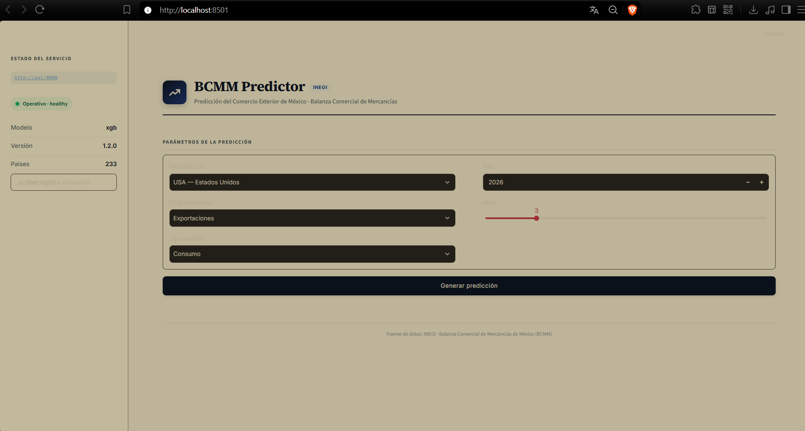
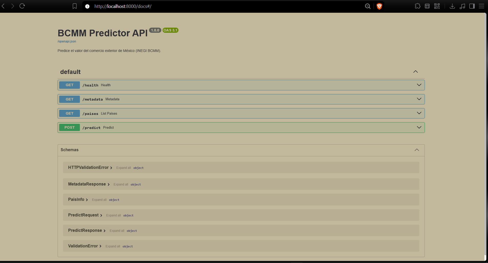
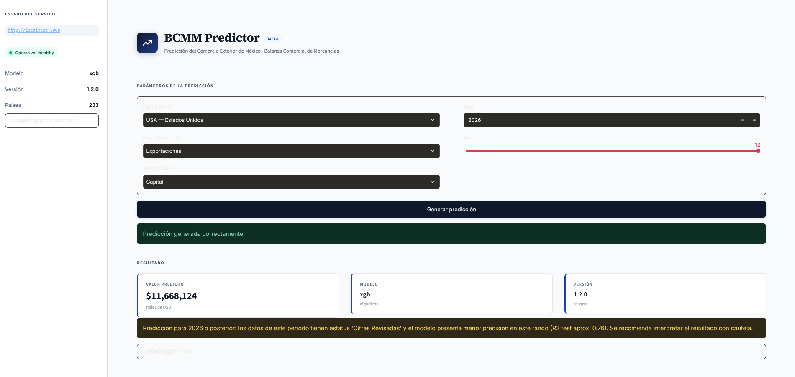
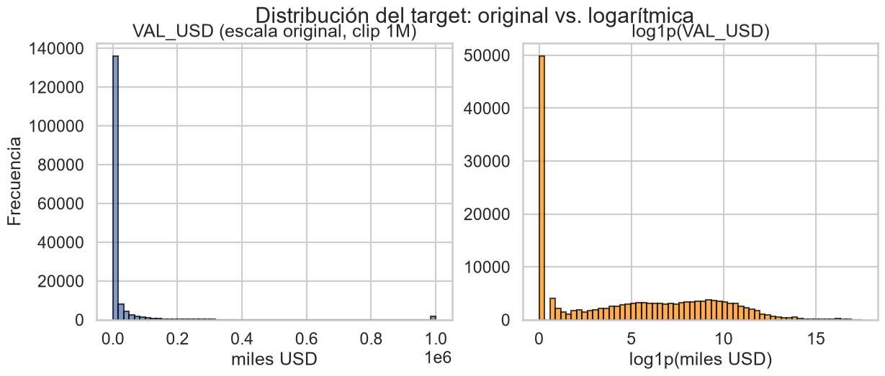
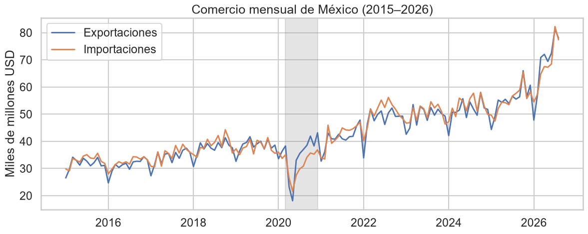
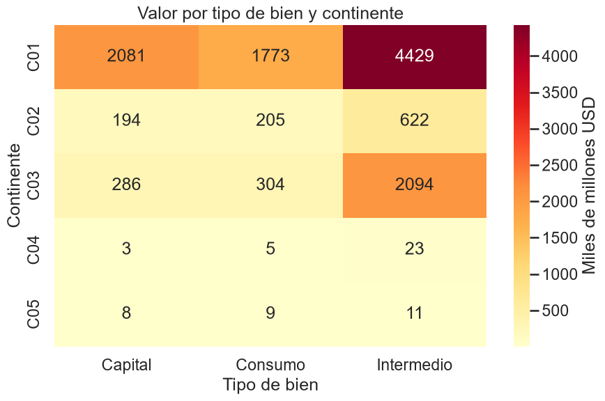
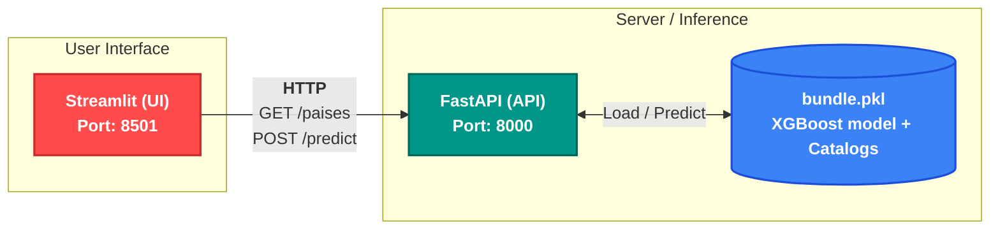

# BCMM Predictor — Mexico's Foreign Trade Forecast

[](https://www.python.org/downloads/)
[](https://fastapi.tiangolo.com/)
[](https://streamlit.io/)
[](https://docs.docker.com/compose/)

 

 

 

Forecasting system for the value of Mexico's foreign trade (exports and imports) based on data from the **Mexico's Merchandise Trade Balance (BCMM)** published by INEGI. The project exposes a **REST API** (FastAPI) and a **web interface** (Streamlit), both containerized with Docker.

---
## Exploratory Data Analysis (EDA)

The full analysis is documented in [`notebooks/notebook.ipynb`](./notebooks/notebook.ipynb). Below is a summary of the key findings that drove the modeling decisions.

### 1. Target distribution (`VAL_USD`) and logarithmic transformation

The value of foreign trade per country and month has a **strongly right-skewed distribution**:

| Statistic | Value (thousands USD) |
|---|---|
| Minimum | 0 |
| 25 % | 0 |
| **Median** | **109** |
| Mean | 72,495 |
| 75 % | 4,846 |
| 99 % | 935,735 |
| Maximum | 39,695,678 |

**Findings:**
- The **median (109)** is ~665× smaller than the **mean (72,495)**, confirming the extreme skew.
- **~25 % of the records are zero** (genuinely zero trade or rounded to 0), which makes direct regression on the raw value unfeasible.
- The **standard deviation (794,349)** is larger than the mean, indicating the overdispersion typical of foreign trade series.

**Decision:** apply `log1p(VAL_USD)` as the target variable (`log1p(x) = log(1 + x)`), which:
- Stabilizes the variance and reduces the effect of outliers (USA–Consumption can represent 39 billion USD while countries like Belize are in the thousands).
- Handles the value 0 without errors (`log1p(0) = 0`).
- Improves convergence of linear and boosting models.

At prediction time, the inverse transformation `expm1(ŷ) - 1` is applied to return the value in thousands of USD.

### 2. Confidential values ("C")

INEGI suppresses operations carried out by one or two informants, flagging them as `"C"` in `VAL_USD`. After loading the CSVs, **pandas automatically converts them to `NaN`**.

| Level | Records | % loss |
|---|---|---|
| Full dataset | 34,628 / 216,792 | **15.97 %** |
| Country level (modeling) | 34,628 / 200,832 | **17.24 %** |

**Additional findings:**
- The proportion of confidential values is **uniform across `TIPO` (export/import) and `TIPO_BIEN` (consumption/intermediate/capital)** (16.5 %–18 % in all cross-tabs), ruling out systematic bias.
- The countries with the highest % of confidential values are **volatile micro-markets** (PNG 63 %, GIB 60 %, LBR 58 %, DJI 57 %, BEN 54 %) that account for less than 0.1 % of total trade.

**Decision:** **confidential rows are removed from the training set** (not imputed). Rationale:
- They are indistinguishable from noise and could bias the model toward artificial intermediate values.
- They represent an acceptable loss (17 %) given that the dataset retains **166,204 rows** for modeling.
- It is documented as a limitation: micro-markets with high confidentiality are underrepresented.

### 3. Country cardinality and encoding strategy

| Variable | Unique values | Strategy |
|---|---|---|
| `PAIS_O_D` | **239** | `TargetEncoder` (with smoothing) |
| `CLAVE_CONTINENTE` | 5 | OneHotEncoder |
| `CLAVE_REGION` | 13 | OneHotEncoder |
| `TIPO` | 2 | OneHotEncoder |
| `TIPO_BIEN` | 3 | OneHotEncoder |
| `ANIO` + `MES` | — | Cyclical encoding (`MES_SIN`, `MES_COS`) |

**Findings:**
- **`PAIS_O_D` has high cardinality (239)** → one-hot encoding would explode into 239 sparse columns and dilute the signal.
- **`TargetEncoder`** was chosen inside the scikit-learn `Pipeline`, which replaces each country with a regularized estimate of the target mean (on the log scale). This:
  - Avoids data leakage (the encoding is fitted only on train within each fold).
  - Captures the inherent economic magnitude of each trading partner (USA ≫ Belize).
  - Keeps the model compact (1 column instead of 239).
- **25 countries have no `CLAVE_CONTINENTE`/`CLAVE_REGION`** in the INEGI dataset (including CHN, JPN, KOR, IND, AUS). The API preserves them with `null` and the model predicts them using the country `TargetEncoder`.

### 4. Monthly seasonality

The aggregated monthly series (2015-01 to 2026-08) has no gaps: **every month is present** with 1,548 records (exceptions due to data status). Typical seasonal patterns of Mexican trade are observed:

- **Peaks in March and October** (quarter-end and agricultural export seasons).
- **Troughs in January** (post-holiday effect) and **December** (industrial shutdowns).
- **Steady upward trend** from 2015 to 2019, a drop in 2020 (COVID-19), and accelerated recovery 2021-2024 (nearshoring).

**Decision:** encode the month as a **cyclical** variable (`MES_SIN = sin(2π·month/12)`, `MES_COS = cos(2π·month/12)`) so the model understands that December and January are "neighbors", preventing a linear model from treating them as distant ordinal values.

### 5. Key visualizations

The following plots from the notebook support the findings above:

#### Target distribution (original vs. logarithmic scale)



*Histogram of `VAL_USD` (left) and `log1p(VAL_USD)` (right). The logarithmic transformation turns a distribution with a very long tail into an approximately normal one, suitable for regression.*

#### Monthly evolution of trade (exports vs. imports)



*Aggregated series 2015-2026 by flow type. Seasonal peaks and the 2020 drop are visible.*

#### Top 15 trading partners of Mexico


*The 15 countries with the highest accumulated trade value. USA accounts for ~60 % of the total, followed by CAN and CHN. The "long-tail" distribution justifies using `TargetEncoder` for the country variable.*

#### `TIPO_BIEN` × `CLAVE_CONTINENTE` heatmap



*Value distribution by good type and continent. America concentrates the largest volume in all categories; Asia shows a higher relative weight in intermediate goods.*


### 6. Modeling decisions derived from the EDA

| Finding | Decision |
|---|---|
| Skewed target + 25 % zeros | `log1p` + inverse `expm1` |
| 239 countries (high cardinality) | `TargetEncoder` (inside the Pipeline) |
| 17 % uniform confidential values | Remove from train (do not impute) |
| Marked seasonality | Cyclical month encoding |
| 25 countries with no geography | API returns `null` in those fields |
| 2015-2022 definitive, 2023-2025 adjusted, 2026 revised | Temporal split (train ≤2023, val 2024, test ≥2025) + API warning for 2026 |

## Architecture



| Component | Technology | Purpose |
|---|---|---|
| `src/data.py` | pandas | Loading, cleaning and enrichment of INEGI CSVs |
| `src/features.py` | pandas, numpy | Feature engineering (target encoding, lags, seasonality) |
| `src/train.py` | scikit-learn, XGBoost | Training and tuning with temporal validation |
| `src/predict.py` | joblib | Bundle loading and single prediction |
| `api/main.py` | FastAPI | REST endpoints with logging and error handling |
| `api/schemas.py` | Pydantic | Request/response contracts |
| `app/streamlit_app.py` | Streamlit | Corporate UI with metrics and form |
| `test/test_api.py` | pytest | 15 integration tests |

---

## Quick start

### Prerequisites

- [uv](https://github.com/astral-sh/uv) (dependency manager)
- Docker + Docker Compose
- The INEGI CSVs in `data/raw/` (see [Data download](https://inegi.org.mx/contenidos/programas/comext/datosabiertos/conjunto_de_datos_bcmm_mensual_paises_bien_csv.zip))

### 1. Install dependencies

```bash
uv sync
```

### 2. Download the INEGI data

Download the open data package for Mexico's Merchandise Trade Balance from the official [INEGI portal (Open Data - Foreign Trade)](https://inegi.org.mx/contenidos/programas/comext/datosabiertos/conjunto_de_datos_bcmm_mensual_paises_bien_csv.zip).

Unzip the file and place the following CSVs inside the `data/raw/` directory:

* **Monthly figure tables:**
  * `bcmm_paises_bien_mensual_tr_cifra_2015_2022.csv`
  * `bcmm_paises_bien_mensual_tr_cifra_2023_2025.csv`
  * `bcmm_paises_bien_mensual_tr_cifra_2026.csv`
* **Catalogs:**
  * `tc_pais.csv`
  * `tc_region.csv`
  * `tc_continente.csv`

The resulting structure should look like this:

```text
data/
└── raw/
    ├── bcmm_paises_bien_mensual_tr_cifra_2015_2022.csv
    ├── bcmm_paises_bien_mensual_tr_cifra_2023_2025.csv
    ├── bcmm_paises_bien_mensual_tr_cifra_2026.csv
    ├── tc_continente.csv
    ├── tc_pais.csv
    └── tc_region.csv
```

### 3. Train the model

```bash
uv run python -m src.train
```

This generates `models/bundle.pkl` (~25 MB) with the XGBoost pipeline and the enriched country *lookup*.

---

### 4. Launch API + UI with Docker

```bash
docker compose up --build
```

* **API (Swagger UI):** [http://localhost:8000/docs](http://localhost:8000/docs)
* **UI (Streamlit):** [http://localhost:8501](http://localhost:8501)

---

### 5. (Alternative) Run without Docker

Run each service in a separate terminal:

```bash
# Terminal 1 — API
uv run uvicorn api.main:app --reload --port 8000
```

```bash
# Terminal 2 — UI
uv run streamlit run app/streamlit_app.py
```

---

## REST API

Interactive documentation available at [http://localhost:8000/docs](http://localhost:8000/docs).

### `GET /health`

Checks the service status and the active model version.

```bash
curl http://localhost:8000/health
```

**Response:**
```json
{
  "status": "healthy",
  "model": "xgb",
  "version": "1.2.0"
}
```

### `GET /metadata`

Returns the model metadata and validation metrics.

### `GET /paises`

Returns the catalog of countries with readable names.

**Response:**
```json
[
  {
    "pais_o_d": "USA",
    "clave_continente": "C01",
    "clave_region": "R01",
    "nombre": "Estados Unidos",
    "nombre_continente": "América",
    "nombre_region": "América del Norte"
  }
]
```

### `POST /predict`

Generates a trade value prediction (in thousands of USD) for a specific country, operation type, good type, and period.

```bash
curl -X POST http://localhost:8000/predict \
  -H "Content-Type: application/json" \
  -d '{
    "pais_o_d": "USA",
    "tipo": "Exportaciones",
    "tipo_bien": "Intermedio",
    "anio": 2024,
    "mes": 6
  }'
```

**Response:**
```json
{
  "predicted_val_usd_miles": 17386382.0,
  "pais_o_d": "USA",
  "nombre": "Estados Unidos",
  "nombre_continente": "América",
  "nombre_region": "América del Norte",
  "tipo": "Exportaciones",
  "tipo_bien": "Intermedio",
  "anio": 2024,
  "mes": 6,
  "model": "xgb",
  "version": "1.2.0",
  "warning": null
}
```
## Design decisions

### Why XGBoost and not Random Forest?
During the comparison phase, Random Forest obtained the best $R^2$ on validation (`0.9900`). However:
* **Bundle size:** RF weighs ~1 GB, while XGB weighs ~25 MB.
* **Inference speed:** XGB is ~5× faster at single prediction.
* **Test $R^2$:** tuned XGB (`0.8433`) is slightly better than tuned RF (`0.8284`).

For deployment on free cloud tiers (Render, Railway, Fly.io), size is decisive. XGBoost is the right engineering decision, even if it is not the maximum-$R^2$ one in cross-validation.

### Why filter out continental aggregates?
The INEGI dataset is an OLAP cube with different levels of aggregation: national, continental, regional, and country. It includes codes like `AME` (America), `ASI` (Asia), `ZZZ` (Unidentified countries), etc., which are not real countries. If the model trains them as if they were countries, it learns artificial patterns that do not generalize.

### Why fall back to `R00` for countries with no region?
24 countries (`CHN`, `JPN`, `KOR`, `IND`, etc.) have no `CLAVE_REGION` assigned in the INEGI catalog. Instead of dropping them (which would mean losing key trading partners), we use:
* `clave_region = "R00"`
* `nombre_region = "Sin región asignada"` (No region assigned)

This keeps the API contract consistent without losing information.

### Why doesn't the model distinguish 2024 from 2025?
The model has no temporal trend *feature*; it only uses `ANIO` and `MES` as raw numbers. For a decision tree, 2024 and 2025 can be indistinguishable if the tree learned that *"any year between 2023-2025 has the same behavior"*. This is a known and documented limitation, reflected in the test `test_predict_usa_2024_y_2025_mismo_nivel`.

> For real time-series forecasting, ARIMA, Prophet, or LSTM with target *lags* would be required.

---

## Model metrics

| Model | $R^2$ val | $R^2$ test | MAE val (thousands USD) | Size |
| :--- | :---: | :---: | :---: | :---: |
| Ridge | 0.7608 | 0.5822 | 49,115 | ~1 MB |
| RF | 0.9651 | 0.8284 | 18,561 | ~1 GB |
| HGB | 0.9373 | 0.7729 | 21,087 | ~15 MB |
| **XGB (production)** | **0.9819** | **0.8433** | **14,199** | **~25 MB** |

> The *gap* between validation (`0.98`) and test (`0.84`) is explained by the 2023 methodological change: INEGI reclassified manufacturing, shifting the target distribution (documented in the official metadata).

---

## Tests

```bash
uv run pytest test/ -v
```

Includes **15 integration tests** covering:
* Model `health` and `metadata`.
* Country catalog (presence of partners, filtering of aggregates, and `R00` *fallback*).
* Valid predictions (USA, China, 2026 with *warning*).
* Expected errors (invalid country, month/year out of range, invalid flow type).
* Known limitations (`2024 ≡ 2025`).

---

## Project structure

```text
.
├── api/
│   ├── main.py              # FastAPI app + endpoints
│   └── schemas.py           # Pydantic contracts
├── app/
│   └── streamlit_app.py     # Corporate UI
├── data/
│   ├── raw/                 # INEGI CSVs (not versioned)
│   └── processed/           # Clean Parquet (not versioned)
├── models/
│   └── bundle.pkl           # Pipeline + lookup (not versioned)
├── notebooks/
│   └── notebook.ipynb       # Exploratory analysis
├── src/
│   ├── data.py              # Loading and cleaning
│   ├── features.py          # Feature engineering
│   ├── train.py             # Training and tuning
│   └── predict.py           # Inference
├── test/
│   └── test_api.py          # Integration tests
├── Dockerfile.api
├── Dockerfile.streamlit
├── docker-compose.yml
├── pyproject.toml
└── uv.lock
```

---

## Environment variables (Optional)

If you want to customize the ports or the API URL, copy the example file and edit it:

```bash
cp .env.example .env
```

---

## Useful commands

```bash
# Install dependencies
uv sync

# Train the model
uv run python -m src.train

# Run tests
uv run pytest test/ -v

# Launch API locally
uv run uvicorn api.main:app --reload --port 8000

# Launch UI locally
uv run streamlit run app/streamlit_app.py

# Docker management
docker compose up --build
docker compose logs -f
docker compose down
```

---

## Data source

**INEGI — Mexico's Merchandise Trade Balance (BCMM)**
* **Program:** [https://www.inegi.org.mx/programas/comext/](https://www.inegi.org.mx/programas/comext/)
* **Coverage:** 2015-01 to 2026-08
* **Units:** Thousands of US dollars (FOB)
* **Frequency:** Monthly
* **Data status:** Definitive (2015-2022), Adjusted (2023-2025), Revised (2026)

---
### Steps to replicate from scratch

```bash
### 1. Clone the repository
git clone https://github.com/angel-monterrosas/machine-learning-zoomcamp.git
cd machine-learning-zoomcamp/homework/Midterm_Project

# 2. Install exact dependencies
uv sync --frozen

# 3. Place the 6 INEGI CSV files in data/raw/ (see Data download section)

# 4. Reproduce the processing and model training
uv run python -m src.train

# 5. Validate the API behavior and contract via tests
uv run pytest test/ -v

# 6. Launch the containerized services
docker compose up --build
```
## License

Educational use — ML Zoomcamp 2025 project.