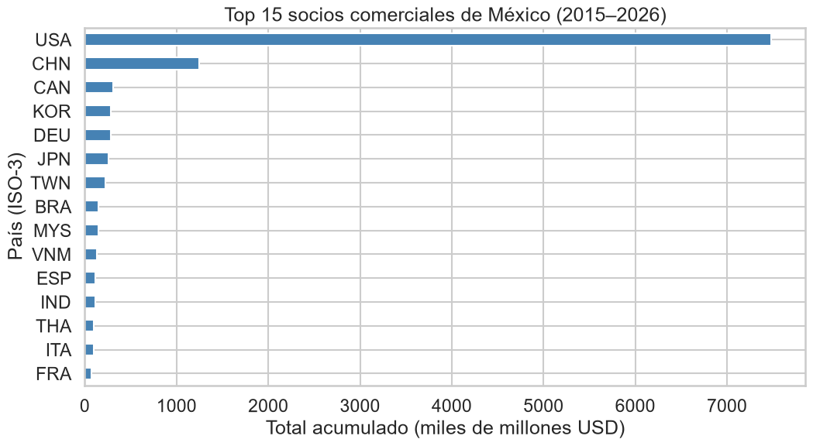
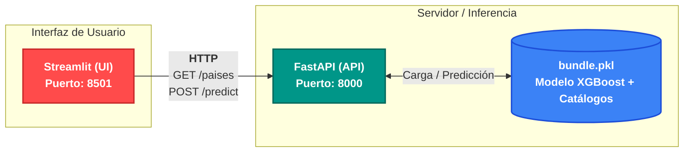

# BCMM Predictor — Predicción del Comercio Exterior de México

[](https://www.python.org/downloads/)
[](https://fastapi.tiangolo.com/)
[](https://streamlit.io/)
[](https://docs.docker.com/compose/)

 

 
Sistema de predicción del valor del comercio exterior de México (exportaciones e importaciones) basado en datos de la **Balanza Comercial de Mercancías de México (BCMM)** del INEGI. El proyecto expone una **API REST** (FastAPI) y una **interfaz web** (Streamlit), ambas containerizadas con Docker.

---
## Análisis Exploratorio de Datos (EDA)

El análisis completo está documentado en [`notebooks/notebook.ipynb`](./notebooks/notebook.ipynb). A continuación se resumen los hallazgos clave que guiaron las decisiones de modelado.

### 1. Distribución del target (`VAL_USD`) y transformación logarítmica

El valor del comercio exterior por país y mes presenta una **distribución fuertemente sesgada a la derecha**:

| Estadístico | Valor (miles USD) |
|---|---|
| Mínimo | 0 |
| 25 % | 0 |
| **Mediana** | **109** |
| Media | 72,495 |
| 75 % | 4,846 |
| 99 % | 935,735 |
| Máximo | 39,695,678 |

**Hallazgos:**
- La **mediana (109)** es ~665× menor que la **media (72,495)**, lo que confirma el sesgo extremo.
- **~25 % de los registros son cero** (comercio real nulo o redondeo a 0), lo que hace inviable una regresión directa sobre el valor bruto.
- La **desviación estándar (794,349)** es mayor que la media, indicando sobredispersión típica de series de comercio exterior.

**Decisión:** aplicar `log1p(VAL_USD)` como variable objetivo (`log1p(x) = log(1 + x)`), lo que:
- Estabiliza la varianza y reduce el efecto de outliers (USA–Consumo puede representar 39 mil millones USD mientras que países como Belice están en miles).
- Maneja el valor 0 sin errores (`log1p(0) = 0`).
- Mejora la convergencia de los modelos lineales y de boosting.

Al predecir, se aplica la transformación inversa `expm1(ŷ) - 1` para devolver el valor en miles de USD.

### 2. Valores confidenciales ("C")

El INEGI suprime las operaciones realizadas por uno o dos informantes, marcándolas con `"C"` en `VAL_USD`. Tras cargar los CSVs, **pandas las convierte automáticamente en `NaN`**.

| Nivel | Registros | % de pérdida |
|---|---|---|
| Dataset completo | 34,628 / 216,792 | **15.97 %** |
| Nivel país (modelado) | 34,628 / 200,832 | **17.24 %** |

**Hallazgos adicionales:**
- La proporción de confidenciales es **uniforme entre `TIPO` (export/import) y `TIPO_BIEN` (consumo/intermedio/capital)** (16.5 %–18 % en todos los cruces), lo que descarta un sesgo sistemático.
- Los países con mayor % de confidenciales son **micro-mercados volátiles** (PNG 63 %, GIB 60 %, LBR 58 %, DJI 57 %, BEN 54 %) que representan menos del 0.1 % del comercio total.

**Decisión:** se **eliminan las filas confidenciales del conjunto de entrenamiento** (no se imputan). Justificación:
- Son indistinguibles del ruido y podrían sesgar el modelo hacia valores intermedios artificiales.
- Representan una pérdida asumible (17 %) dado que el dataset conserva **166,204 filas** para modelado.
- Se documenta como limitación: los micro-mercados con alta confidencialidad quedan subrepresentados.

### 3. Cardinalidad de países y estrategia de codificación

| Variable | Valores únicos | Estrategia |
|---|---|---|
| `PAIS_O_D` | **239** | `TargetEncoder` (con smoothing) |
| `CLAVE_CONTINENTE` | 5 | OneHotEncoder |
| `CLAVE_REGION` | 13 | OneHotEncoder |
| `TIPO` | 2 | OneHotEncoder |
| `TIPO_BIEN` | 3 | OneHotEncoder |
| `ANIO` + `MES` | — | Codificación cíclica (`MES_SIN`, `MES_COS`) |

**Hallazgos:**
- **`PAIS_O_D` tiene alta cardinalidad (239)** → un one-hot explotaría a 239 columnas dispersas y diluiría la señal.
- Se optó por **`TargetEncoder`** dentro del `Pipeline` de scikit-learn, que reemplaza cada país por una estimación regularizada de la media del target (en escala log). Esto:
  - Evita data leakage (el encoding se ajusta solo en train dentro de cada fold).
  - Captura la magnitud económica inherente de cada socio comercial (USA ≫ Belice).
  - Mantiene el modelo compacto (1 columna en lugar de 239).
- **25 países no tienen `CLAVE_CONTINENTE`/`CLAVE_REGION`** en el dataset del INEGI (incluyendo CHN, JPN, KOR, IND, AUS). La API los conserva con `null` y el modelo los predice usando el `TargetEncoder` de país.

### 4. Estacionalidad mensual

La serie mensual agregada (2015-01 a 2026-08) no muestra huecos: **todos los meses están presentes** con 1,548 registros (excepciones por estatus de cifra). Se observan patrones estacionales típicos del comercio mexicano:

- **Picos en marzo y octubre** (cierre de trimestres y temporadas de exportación agropecuaria).
- **Valles en enero** (efecto post-vacacional) y **diciembre** (paros industriales).
- **Tendencia creciente** sostenida de 2015 a 2019, caída en 2020 (COVID-19), y recuperación acelerada 2021-2024 (nearshoring).

**Decisión:** codificar el mes como variable **cíclica** (`MES_SIN = sin(2π·mes/12)`, `MES_COS = cos(2π·mes/12)`) para que el modelo entienda que diciembre y enero son "vecinos", evitando que un modelo lineal los trate como valores ordinales distantes.

### 5. Visualizaciones clave

Las siguientes gráficas del notebook respaldan los hallazgos anteriores:

#### Distribución del target (escala original vs. logarítmica)


*Histograma de `VAL_USD` (izq.) y de `log1p(VAL_USD)` (der.). La transformación logarítmica convierte una distribución con cola larguísima en una aproximadamente normal, adecuada para regresión.*

#### Evolución mensual del comercio (exportaciones vs. importaciones)


*Serie agregada 2015-2026 por tipo de flujo. Se observan los picos estacionales y la caída de 2020.*

#### Top 15 socios comerciales de México



*Los 15 países con mayor valor acumulado de comercio. USA concentra ~60 % del total, seguido de CAN y CHN. La distribución "long-tail" justifica el uso de `TargetEncoder` para la variable de país.*

#### Mapa de calor `TIPO_BIEN` × `CLAVE_CONTINENTE`


*Distribución del valor por tipo de bien y continente. América concentra el mayor volumen en todas las categorías; Asia muestra mayor peso relativo en bienes intermedios.*


### 6. Decisiones de modelado derivadas del EDA

| Hallazgo | Decisión |
|---|---|
| Target sesgado + 25 % ceros | `log1p` + `expm1` inverso |
| 239 países (alta cardinalidad) | `TargetEncoder` (dentro del Pipeline) |
| 17 % confidenciales uniformes | Eliminar del train (no imputar) |
| Estacionalidad marcada | Codificación cíclica del mes |
| 25 países sin geografía | API devuelve `null` en esos campos |
| 2015-2022 definitivas, 2023-2025 ajustadas, 2026 revisadas | Split temporal (train ≤2023, val 2024, test ≥2025) + warning en API para 2026 |
## Arquitectura



| Componente | Tecnología | Propósito |
|---|---|---|
| `src/data.py` | pandas | Carga, limpieza y enriquecimiento de CSVs del INEGI |
| `src/features.py` | pandas, numpy | Ingeniería de features (target encoding, lags, estacionalidad) |
| `src/train.py` | scikit-learn, XGBoost | Entrenamiento y tuning con validación temporal |
| `src/predict.py` | joblib | Carga del bundle y predicción individual |
| `api/main.py` | FastAPI | Endpoints REST con logs y manejo de errores |
| `api/schemas.py` | Pydantic | Contratos de request/response |
| `app/streamlit_app.py` | Streamlit | UI corporativa con métricas y formulario |
| `test/test_api.py` | pytest | 15 tests de integración |

---

## Inicio rápido

### Pre-requisitos

- [uv](https://github.com/astral-sh/uv) (gestor de dependencias)
- Docker + Docker Compose
- Los CSVs del INEGI en `data/raw/` (ver [Descarga de datos](https://inegi.org.mx/contenidos/programas/comext/datosabiertos/conjunto_de_datos_bcmm_mensual_paises_bien_csv.zip))

### 1. Instalar dependencias

```bash
uv sync
```

### 2. Descargar los datos del INEGI

Descarga el paquete de datos abiertos de la Balanza Comercial de Mercancías de México desde el portal oficial del [INEGI (Datos Abiertos - Comercio Exterior)](https://inegi.org.mx/contenidos/programas/comext/datosabiertos/conjunto_de_datos_bcmm_mensual_paises_bien_csv.zip).

Descomprime el archivo y coloca los siguientes CSV dentro del directorio `data/raw/`:

* **Tablas de cifras mensuales:**
  * `bcmm_paises_bien_mensual_tr_cifra_2015_2022.csv`
  * `bcmm_paises_bien_mensual_tr_cifra_2023_2025.csv`
  * `bcmm_paises_bien_mensual_tr_cifra_2026.csv`
* **Catálogos:**
  * `tc_pais.csv`
  * `tc_region.csv`
  * `tc_continente.csv`

La estructura resultante debe verse así:

```text
data/
└── raw/
    ├── bcmm_paises_bien_mensual_tr_cifra_2015_2022.csv
    ├── bcmm_paises_bien_mensual_tr_cifra_2023_2025.csv
    ├── bcmm_paises_bien_mensual_tr_cifra_2026.csv
    ├── tc_continente.csv
    ├── tc_pais.csv
    └── tc_region.csv
```
### 3. Entrenar el modelo

```bash
uv run python -m src.train
```

Esto genera `models/bundle.pkl` (~25 MB) con el pipeline de XGBoost y el *lookup* de países enriquecido.

---

### 4. Levantar API + UI con Docker

```bash
docker compose up --build
```

* **API (Swagger UI):** [http://localhost:8000/docs](http://localhost:8000/docs)
* **UI (Streamlit):** [http://localhost:8501](http://localhost:8501)

---

### 5. (Alternativa) Levantar sin Docker

Ejecuta cada servicio en una terminal distinta:

```bash
# Terminal 1 — API
uv run uvicorn api.main:app --reload --port 8000
```

```bash
# Terminal 2 — UI
uv run streamlit run app/streamlit_app.py
```

---

## API REST

Documentación interactiva disponible en [http://localhost:8000/docs](http://localhost:8000/docs).

### `GET /health`

Verifica el estado del servicio y la versión activa del modelo.

```bash
curl http://localhost:8000/health
```

**Respuesta:**
```json
{
  "status": "healthy",
  "model": "xgb",
  "version": "1.2.0"
}
```

### `GET /metadata`

Devuelve los metadatos del modelo y las métricas de validación.

### `GET /paises`

Devuelve el catálogo de países con nombres legibles.

**Respuesta:**
```json
[
  {
    "pais_o_d": "USA",
    "clave_continente": "C01",
    "clave_region": "R01",
    "nombre": "Estados Unidos",
    "nombre_continente": "América",
    "nombre_region": "América del Norte"
  }
]
```

### `POST /predict`

Genera una predicción del valor comercial (en miles de USD) para un país, tipo de operación, tipo de bien y periodo específicos.

```bash
curl -X POST http://localhost:8000/predict \
  -H "Content-Type: application/json" \
  -d '{
    "pais_o_d": "USA",
    "tipo": "Exportaciones",
    "tipo_bien": "Intermedio",
    "anio": 2024,
    "mes": 6
  }'
```

**Respuesta:**
```json
{
  "predicted_val_usd_miles": 17386382.0,
  "pais_o_d": "USA",
  "nombre": "Estados Unidos",
  "nombre_continente": "América",
  "nombre_region": "América del Norte",
  "tipo": "Exportaciones",
  "tipo_bien": "Intermedio",
  "anio": 2024,
  "mes": 6,
  "model": "xgb",
  "version": "1.2.0",
  "warning": null
}
```
## Decisiones de diseño

### ¿Por qué XGBoost y no Random Forest?
En la fase de comparación, Random Forest obtuvo el mejor $R^2$ en validación (`0.9900`). Sin embargo:
* **Tamaño del bundle:** RF pesa ~1 GB, mientras que XGB pesa ~25 MB.
* **Velocidad de inferencia:** XGB es ~5x más rápido en predicción individual.
* **$R^2$ en test:** XGB *tuning* (`0.8433`) es ligeramente mejor que RF *tuning* (`0.8284`).

Para un despliegue en cloud gratuito (Render, Railway, Fly.io), el tamaño es determinante. XGBoost es la decisión de ingeniería correcta, aunque no sea la de máximo $R^2$ en validación cruzada.

### ¿Por qué filtrar agregados continentales?
El dataset del INEGI es un cubo OLAP con distintos niveles de agregación: nacional, continental, regional y país. Incluye códigos como `AME` (América), `ASI` (Asia), `ZZZ` (Países no identificados), etc., que no son países reales. Si el modelo los entrena como si fueran países, aprende patrones artificiales que no generalizan.

### ¿Por qué fallback `R00` para países sin región?
24 países (`CHN`, `JPN`, `KOR`, `IND`, etc.) no tienen `CLAVE_REGION` asignada en el catálogo del INEGI. En lugar de eliminarlos (lo que implicaría perder socios comerciales clave), usamos:
* `clave_region = "R00"`
* `nombre_region = "Sin región asignada"`

Esto mantiene la consistencia del contrato de la API sin perder información.

### ¿Por qué el modelo no diferencia 2024 de 2025?
El modelo no tiene una *feature* de tendencia temporal; solo usa `ANIO` y `MES` como números crudos. Para un árbol de decisión, 2024 y 2025 pueden ser indistinguibles si el árbol aprendió que *"cualquier año entre 2023-2025 tiene el mismo comportamiento"*. Esta es una limitación conocida y documentada, reflejada en el test `test_predict_usa_2024_y_2025_mismo_nivel`.

> Para pronóstico real de series de tiempo, se necesitaría ARIMA, Prophet o LSTM con *lags* del target.

---

## Métricas del modelo

| Modelo | $R^2$ val | $R^2$ test | MAE val (miles USD) | Tamaño |
| :--- | :---: | :---: | :---: | :---: |
| Ridge | 0.7608 | 0.5822 | 49,115 | ~1 MB |
| RF | 0.9651 | 0.8284 | 18,561 | ~1 GB |
| HGB | 0.9373 | 0.7729 | 21,087 | ~15 MB |
| **XGB (producción)** | **0.9819** | **0.8433** | **14,199** | **~25 MB** |

> El *gap* entre validación (`0.98`) y test (`0.84`) se explica por el cambio metodológico de 2023: el INEGI reclasificó las manufacturas, cambiando la distribución del target (documentado en los metadatos oficiales).

---

## Tests

```bash
uv run pytest test/ -v
```

Incluye **15 tests de integración** que cubren:
* `Health` y `metadata` del modelo.
* Catálogo de países (presencia de socios, filtrado de agregados y *fallback* `R00`).
* Predicciones válidas (USA, China, 2026 con *warning*).
* Errores esperados (país inválido, mes/año fuera de rango, tipo de flujo inválido).
* Limitaciones conocidas (`2024 ≡ 2025`).

---

## Estructura del proyecto

```text
.
├── api/
│   ├── main.py              # FastAPI app + endpoints
│   └── schemas.py           # Contratos Pydantic
├── app/
│   └── streamlit_app.py     # UI corporativa
├── data/
│   ├── raw/                 # CSVs del INEGI (no versionados)
│   └── processed/           # Parquet limpio (no versionado)
├── models/
│   └── bundle.pkl           # Pipeline + lookup (no versionado)
├── notebooks/
│   └── notebook.ipynb            # Análisis exploratorio
├── src/
│   ├── data.py              # Carga y limpieza
│   ├── features.py          # Ingeniería de features
│   ├── train.py             # Entrenamiento y tuning
│   └── predict.py           # Inferencia
├── test/
│   └── test_api.py          # Tests de integración
├── Dockerfile.api
├── Dockerfile.streamlit
├── docker-compose.yml
├── pyproject.toml
└── uv.lock
```

---

## Variables de entorno (Opcional)

Si deseas personalizar los puertos o la URL de la API, copia el archivo de ejemplo y edítalo:

```bash
cp .env.example .env
```

---

## Comandos útiles

```bash
# Instalar dependencias
uv sync

# Entrenar el modelo
uv run python -m src.train

# Ejecutar tests
uv run pytest test/ -v

# Levantar API local
uv run uvicorn api.main:app --reload --port 8000

# Levantar UI local
uv run streamlit run app/streamlit_app.py

# Gestión con Docker
docker compose up --build
docker compose logs -f
docker compose down
```

---

## Fuente de datos

**INEGI — Balanza Comercial de Mercancías de México (BCMM)**
* **Programa:** [https://www.inegi.org.mx/programas/comext/](https://www.inegi.org.mx/programas/comext/)
* **Cobertura:** 2015-01 a 2026-08
* **Unidades:** Miles de dólares estadounidenses (FOB)
* **Frecuencia:** Mensual
* **Estatus de cifras:** Definitivas (2015-2022), Ajustadas (2023-2025), Revisadas (2026)

---
### Pasos para replicar desde cero

```bash
### 1. Clonar el repositorio
git clone https://github.com/angel-monterrosas/machine-learning-zoomcamp.git
cd machine-learning-zoomcamp/homework/Midterm_Project

# 2. Instalar dependencias exactas
uv sync --frozen

# 3. Colocar los 6 archivos CSV del INEGI en data/raw/ (ver sección Descarga de datos)

# 4. Reproducir el procesamiento y entrenamiento del modelo
uv run python -m src.train

# 5. Validar el comportamiento y contrato de la API mediante tests
uv run pytest test/ -v

# 6. Levantar los servicios containerizados
docker compose up --build
```
## Licencia

Uso educativo — Proyecto del ML Zoomcamp 2025.